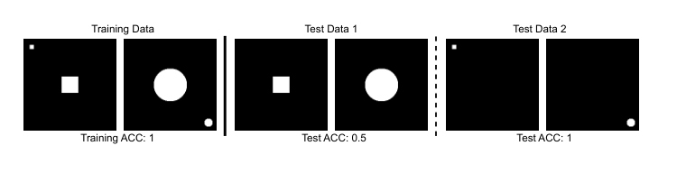

# AttributionLab：动机核读

原文：https://arxiv.org/html/2310.06514v2 。2023年首稿、2024年修订。本轮核读§2–3、§5及局限，讲解限动机与核心设计。

导读地图：①数据标签真值与模型依赖的区别（图3）；②人工网络的颜色检测与累加模块（§3）；③归因方法评测（§4）；④扰动评价的未见输入效应（§5）。后续章节未逐站讲解。

关键点：作者联合设计数据与网络权重，使依赖可知，再审计归因方法；不直接审计现成鉴伪VLM的文字理由。合成环境检查通过不保证真实场景忠实。图片来自原文图3，由PDF裁出。

与本项目的关系（分析）：源图、编辑位置和伪造标签可知，不自动给出现成检测器的内部依据真值；仍需独立检验其对目标线索及操作对照的响应。

材料限制：kelip技能所列fetch_paper.py在本机缺失，搜索未找到；改用官方HTML与手动下载公开PDF，未取得源码和确认官方代码，不声称完成完整精读材料管线。PDF为临时核读材料，不提交。
